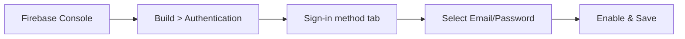
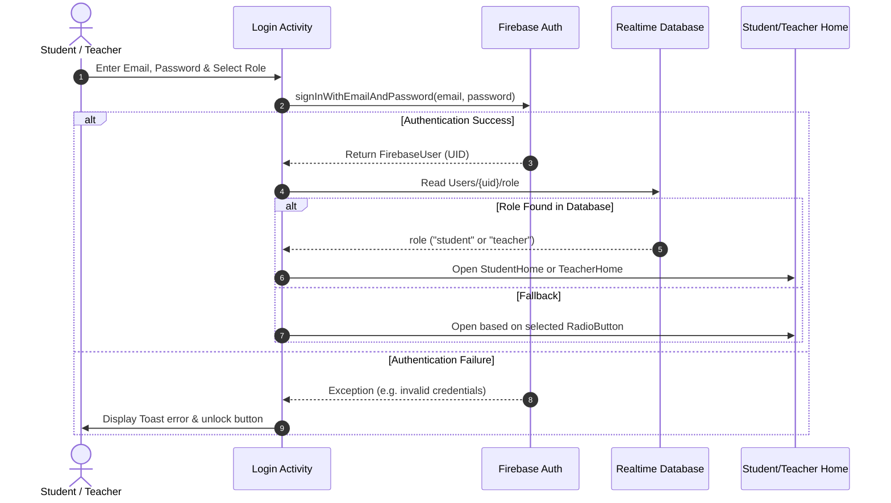

# Firebase Authentication & Login Milestone Guide

## 1. Overview

In this milestone, Firebase Email/Password Authentication is integrated with role-based routing between **Teacher/Recruiter** and **Student** accounts.

### Implemented Capabilities
- **Email & Password Authentication**: Validates credentials using `FirebaseAuth`.
- **Material Components UI**: Built using `TextInputLayout`, `TextInputEditText`, `MaterialButton`, and `MaterialCardView`.
- **Role Differentiation**: Supports dual roles (**Student** vs **Teacher / Recruiter**).
- **User Profile Persistence**: Stores user details (UID, name, email, role) in Firebase Realtime Database.
- **Self-Service Registration**: [`Register.java`](file:///C:/Users/Sreevas/.gemini/antigravity/scratch/ExamQuizApp/app/src/main/java/com/example/quizapp/Register.java) for creating new student or teacher accounts.
- **Password Recovery**: Reset password dialog directly triggered from the login screen.

---

## 2. Enabling Email/Password in Firebase Console

Before testing logins, ensure the **Email/Password** provider is enabled in your Firebase project:

1. Open the [Firebase Console](https://console.firebase.google.com/).
2. Select your project (e.g. `ExamQuizApp`).
3. In the left navigation bar, go to **Build > Authentication**.
4. Click **Get Started** (if opening Authentication for the first time).
5. Switch to the **Sign-in method** tab.
6. Click on **Email/Password** in the provider list.
7. Toggle the first switch **Enable** to ON. (Leave *Email link / passwordless* disabled).
8. Click **Save**.



---

## 3. Project Implementation Details

### A. Dependencies ([`app/build.gradle`](file:///C:/Users/Sreevas/.gemini/antigravity/scratch/ExamQuizApp/app/build.gradle))
The module includes the Firebase BoM and `firebase-auth`:
```groovy
// Firebase BoM (Bill of Materials)
implementation platform('com.google.firebase:firebase-bom:33.4.0')
// Firebase Authentication library
implementation 'com.google.firebase:firebase-auth'
// Firebase Realtime Database for profile & quiz storage
implementation 'com.google.firebase:firebase-database'
```

### B. Core Source Files
| File | Path / Link | Description |
| :--- | :--- | :--- |
| **Login Activity** | [`Login.java`](file:///C:/Users/Sreevas/.gemini/antigravity/scratch/ExamQuizApp/app/src/main/java/com/example/quizapp/Login.java) | Handles credential validation, `signInWithEmailAndPassword`, and role redirect |
| **Login Layout** | [`activity_login.xml`](file:///C:/Users/Sreevas/.gemini/antigravity/scratch/ExamQuizApp/app/src/main/res/layout/activity_login.xml) | Material Design login interface with role toggle |
| **Register Activity** | [`Register.java`](file:///C:/Users/Sreevas/.gemini/antigravity/scratch/ExamQuizApp/app/src/main/java/com/example/quizapp/Register.java) | Creates user with `createUserWithEmailAndPassword` and persists user metadata |
| **Register Layout** | [`activity_register.xml`](file:///C:/Users/Sreevas/.gemini/antigravity/scratch/ExamQuizApp/app/src/main/res/layout/activity_register.xml) | Account creation screen with Name, Role, Email, Password |
| **User Model** | [`User.java`](file:///C:/Users/Sreevas/.gemini/antigravity/scratch/ExamQuizApp/app/src/main/java/com/example/quizapp/User.java) | POJO data model (`uid`, `name`, `email`, `role`) |
| **Student Portal** | [`StudentHomeActivity.java`](file:///C:/Users/Sreevas/.gemini/antigravity/scratch/ExamQuizApp/app/src/main/java/com/example/quizapp/StudentHomeActivity.java) | Landing dashboard for students |
| **Teacher Portal** | [`TeacherHomeActivity.java`](file:///C:/Users/Sreevas/.gemini/antigravity/scratch/ExamQuizApp/app/src/main/java/com/example/quizapp/TeacherHomeActivity.java) | Landing dashboard for teachers |

---

## 4. Authentication Workflow



---

## 5. Verification Checklist

1. [x] Add Firebase Auth dependency in `app/build.gradle`.
2. [x] Create `Login` activity with Material Components styling.
3. [x] Add client-side validation for email syntax and password length.
4. [x] Connect `mAuth.signInWithEmailAndPassword()`.
5. [x] Register `Login` in `AndroidManifest.xml`.
6. [x] Provide account creation (`Register.java`) and password reset mechanisms.
