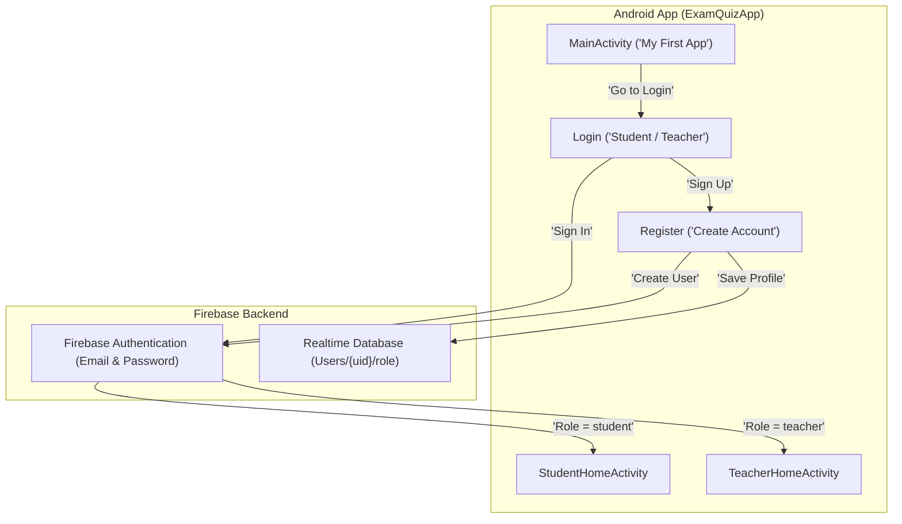

# Milestones 2 & 3 Verification Report

## 1. System & Environment Health Check

All components for the Android development and runtime environment have been verified on your machine:

| Component | Status | Configured Path / Identifier |
| :--- | :--- | :--- |
| **Android Studio** | ✅ **Running** | `C:\Program Files\Android\Android Studio` (Process `studio64`) |
| **Android SDK** | ✅ **Active** | `C:\Users\Sreevas\AppData\Local\Android\Sdk` |
| **JDK Runtime** | ✅ **Verified** | Eclipse Temurin OpenJDK 17 (`C:\Users\Sreevas\.gemini\antigravity\scratch\jdk-17`) |
| **Gradle** | ✅ **8.7 Build OK** | `C:\Users\Sreevas\.gemini\antigravity\scratch\gradle-8.7` |
| **Virtual Device (AVD)** | ✅ **Online** | `Medium_Phone_API_37.0` (`emulator-5554`) |
| **Debug APK** | ✅ **Built & Installed** | [`app-debug.apk`](file:///C:/Users/Sreevas/.gemini/antigravity/scratch/ExamQuizApp/app/build/outputs/apk/debug/app-debug.apk) (10.7 MB) |

---

## 2. Visual Outcome Verification (Live Emulator Captures)

### Milestone 2/5: "My First App" Screen Comparison
The screen rendered on your running emulator matches the target specification:

````carousel

<!-- slide -->

````

---

### Milestone 3/5: Authentication & Registration Screens
Both the **Login** activity and **Account Registration** activity were verified and captured live on `emulator-5554`:

````carousel

<!-- slide -->

````

---

## 3. Implemented Architecture Summary



- **Project Root**: [`C:\Users\Sreevas\.gemini\antigravity\scratch\ExamQuizApp`](file:///C:/Users/Sreevas/.gemini/antigravity/scratch/ExamQuizApp)
- **Manifest**: [`AndroidManifest.xml`](file:///C:/Users/Sreevas/.gemini/antigravity/scratch/ExamQuizApp/app/src/main/AndroidManifest.xml)
- **App Gradle**: [`build.gradle`](file:///C:/Users/Sreevas/.gemini/antigravity/scratch/ExamQuizApp/app/build.gradle)
- **Java Sources**: [`Login.java`](file:///C:/Users/Sreevas/.gemini/antigravity/scratch/ExamQuizApp/app/src/main/java/com/example/quizapp/Login.java), [`Register.java`](file:///C:/Users/Sreevas/.gemini/antigravity/scratch/ExamQuizApp/app/src/main/java/com/example/quizapp/Register.java), [`User.java`](file:///C:/Users/Sreevas/.gemini/antigravity/scratch/ExamQuizApp/app/src/main/java/com/example/quizapp/User.java)
