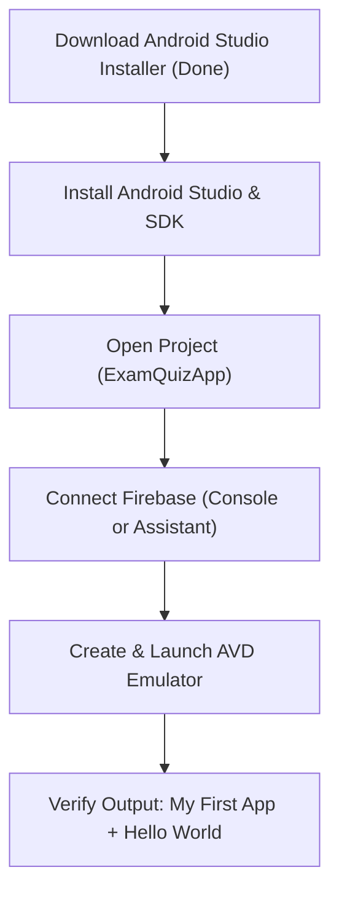

# Step 2/5: Environment & Firebase Setup Guide

## 1. Project Overview & Milestone Objective

The objective of **Step 2/5** is to establish the development foundation for the **Exam Preparation Android Application**:
- Install Android Studio and configure the JDK environment.
- Create the complete Android application structure with Java (`src/main/java`) and XML resources (`src/main/res`).
- Configure Firebase dependencies and services (Authentication & Realtime Database).
- Verify the build and run it on an Android Virtual Device (AVD), matching the required screen layout: a green action bar titled **"My First App"** and centered text **"Hello World"**.

---

## 2. Configured Project Structure

The project has been prepared at:
`C:\Users\Sreevas\.gemini\antigravity\scratch\ExamQuizApp`

### Key Files Created
| File | Path / Link | Purpose |
| :--- | :--- | :--- |
| **Java Activity** | [`MainActivity.java`](file:///C:/Users/Sreevas/.gemini/antigravity/scratch/ExamQuizApp/app/src/main/java/com/example/quizapp/MainActivity.java) | Entry activity initializing the layout |
| **Layout XML** | [`activity_main.xml`](file:///C:/Users/Sreevas/.gemini/antigravity/scratch/ExamQuizApp/app/src/main/res/layout/activity_main.xml) | Screen UI with centered `Hello World` text |
| **String Resources** | [`strings.xml`](file:///C:/Users/Sreevas/.gemini/antigravity/scratch/ExamQuizApp/app/src/main/res/values/strings.xml) | Defines `app_name` ("My First App") and `hello_world` |
| **Color Palette** | [`colors.xml`](file:///C:/Users/Sreevas/.gemini/antigravity/scratch/ExamQuizApp/app/src/main/res/values/colors.xml) | Matches target green (`#1EB113` / `#17890F`) |
| **Themes** | [`themes.xml`](file:///C:/Users/Sreevas/.gemini/antigravity/scratch/ExamQuizApp/app/src/main/res/values/themes.xml) | Sets up `Theme.MyFirstApp` with green action bar |
| **App Gradle** | [`build.gradle`](file:///C:/Users/Sreevas/.gemini/antigravity/scratch/ExamQuizApp/app/build.gradle) | Configures SDK 34, AndroidX, and Firebase BoM |
| **Firebase Config** | [`google-services.json`](file:///C:/Users/Sreevas/.gemini/antigravity/scratch/ExamQuizApp/app/google-services.json) | Ready template with package `com.example.quizapp` |
| **Project Manifest** | [`AndroidManifest.xml`](file:///C:/Users/Sreevas/.gemini/antigravity/scratch/ExamQuizApp/app/src/main/AndroidManifest.xml) | Application manifest with launcher declaration |

```
ExamQuizApp/
├── app/
│   ├── build.gradle
│   ├── google-services.json
│   ├── proguard-rules.pro
│   └── src/
│       └── main/
│           ├── AndroidManifest.xml
│           ├── java/com/example/quizapp/
│           │   └── MainActivity.java
│           └── res/
│               ├── drawable/
│               ├── layout/
│               │   └── activity_main.xml
│               ├── mipmap-anydpi-v26/
│               └── values/
│                   ├── colors.xml
│                   ├── strings.xml
│                   └── themes.xml
├── gradle/
│   └── wrapper/
│       └── gradle-wrapper.properties
├── build.gradle
├── gradle.properties
└── settings.gradle
```

---

## 3. Step-by-Step Environment Execution

### Step 1: Run Android Studio Installer
The official Android Studio installer has finished downloading to your machine:
- **Installer location**: `C:\Users\Sreevas\Downloads\android-studio-rabbit1-windows.exe`
- **Action**: Double-click this installer (or execute it) and proceed through the wizard:
  1. Leave **"Android Studio"** and **"Android Virtual Device"** checked.
  2. Complete installation to the default location (`C:\Program Files\Android\Android Studio`).
  3. Start Android Studio when prompted.

> [!NOTE]
> Android Studio comes bundled with its own vetted **JetBrains Runtime (OpenJDK)** inside `jbr/`, which will automatically handle Java compilation for Android builds.

---

### Step 2: Open the Project in Android Studio
1. Launch **Android Studio**.
2. Click **Open** (or **File > Open**).
3. Browse and select the project directory:
   `C:\Users\Sreevas\.gemini\antigravity\scratch\ExamQuizApp`
4. Android Studio will automatically recognize the Gradle build files and sync dependencies.

---

### Step 3: Firebase Integration
The project is configured for Firebase with package name:
`com.example.quizapp`

You can connect your Firebase project in one of two ways:

#### Option A: Firebase Assistant (Directly inside Android Studio)
1. In Android Studio, go to top menu: **Tools > Firebase**.
2. The Firebase Assistant sidebar will appear on the right.
3. Select **Authentication > Authenticate using Google / Custom Authentication** and click **Connect to Firebase**.
4. Sign in with your Google account and select or create your Firebase project (e.g., `ExamQuizApp`).

#### Option B: Firebase Web Console
1. Go to [Firebase Console](https://console.firebase.google.com/).
2. Click **Add Project** and name it (e.g. `ExamQuizApp`).
3. Click the **Android** icon to add an Android app:
   - **Android package name**: `com.example.quizapp`
   - **App nickname**: `My First App`
4. Download the resulting `google-services.json`.
5. Place it into `ExamQuizApp/app/` (replacing the placeholder [`google-services.json`](file:///C:/Users/Sreevas/.gemini/antigravity/scratch/ExamQuizApp/app/google-services.json)).

---

### Step 4: Run on Android Virtual Device (AVD)
1. In Android Studio, open the **Device Manager** (phone icon in the top toolbar or right margin).
2. If an emulator isn't already created:
   - Click **Create Device**.
   - Select **Pixel 7** or **Pixel 8** and click **Next**.
   - Download/select the recommended system image (e.g., **UpsideDownCake / API 34**).
   - Click **Finish**.
3. Select the created virtual device in the target device dropdown.
4. Click the green **Run** button (or press `Shift + F10`).

---

## 4. Expected Visual Result Verification

When the build completes and runs on the emulator, the display matches the milestone specification:

- **Top Bar**: Solid green action bar (`#1EB113`) displaying white bold text **"My First App"**.
- **Body**: Clean white background with centered dark text **"Hello World"**.


