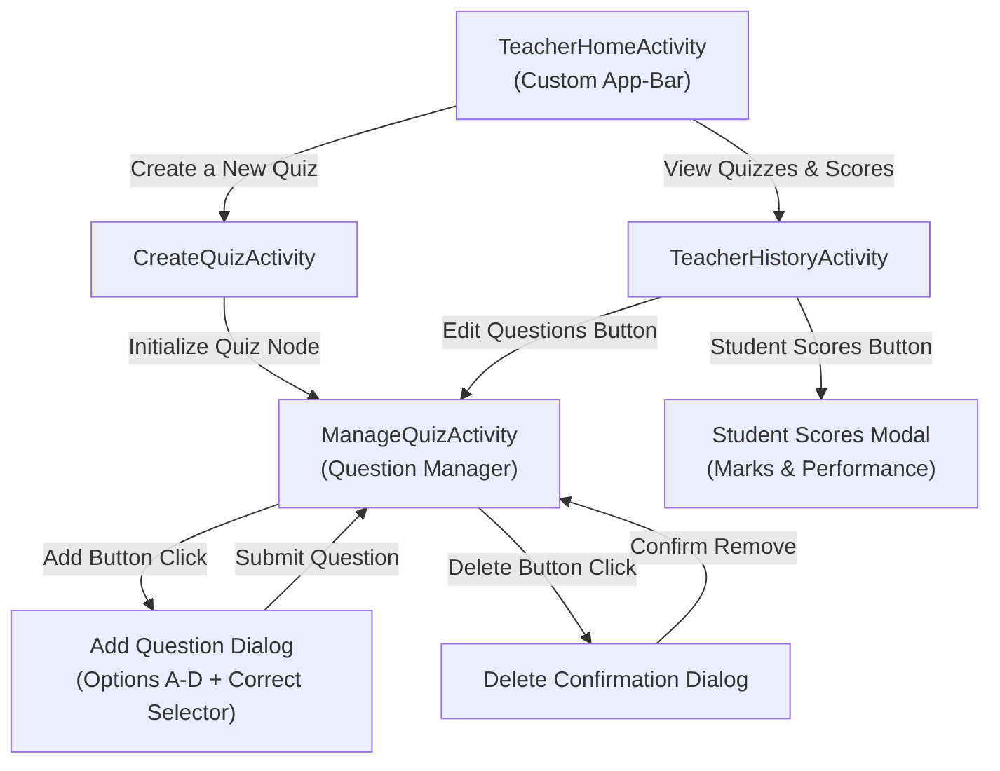
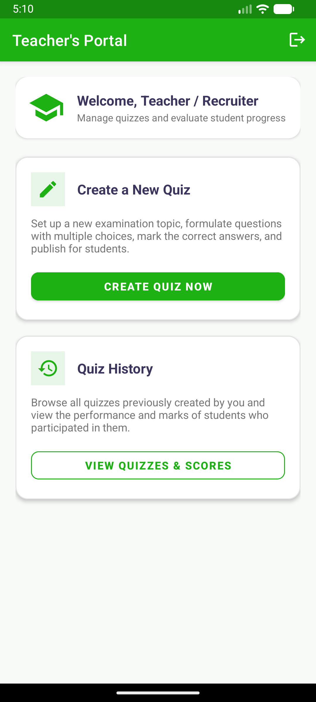
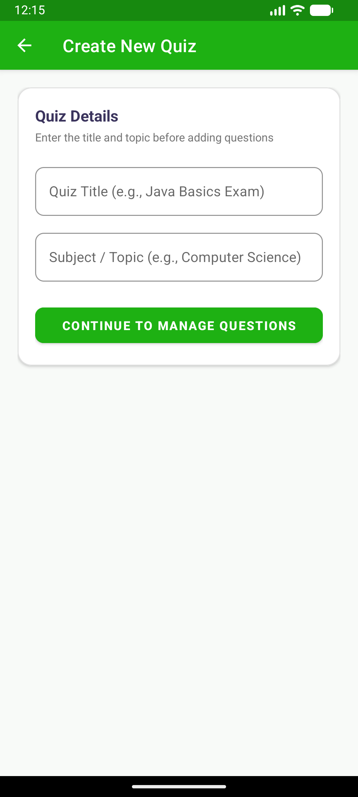
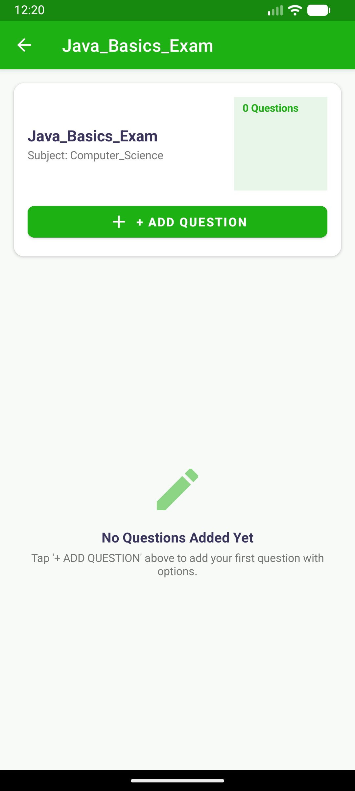
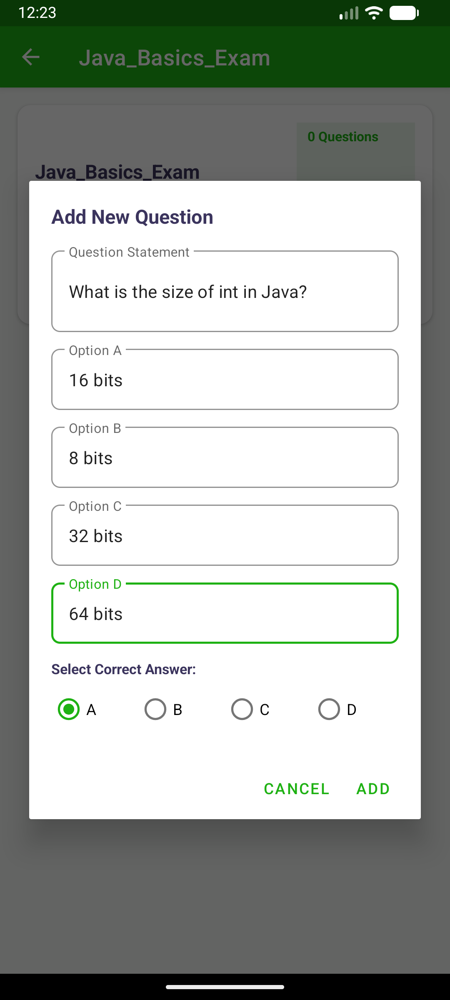
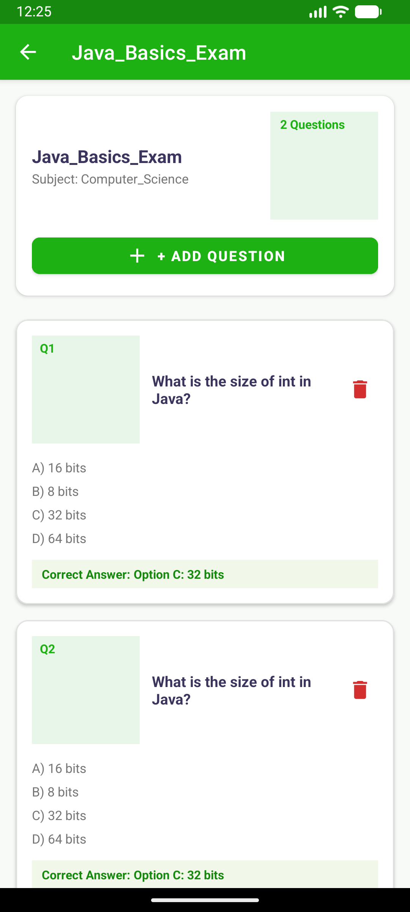
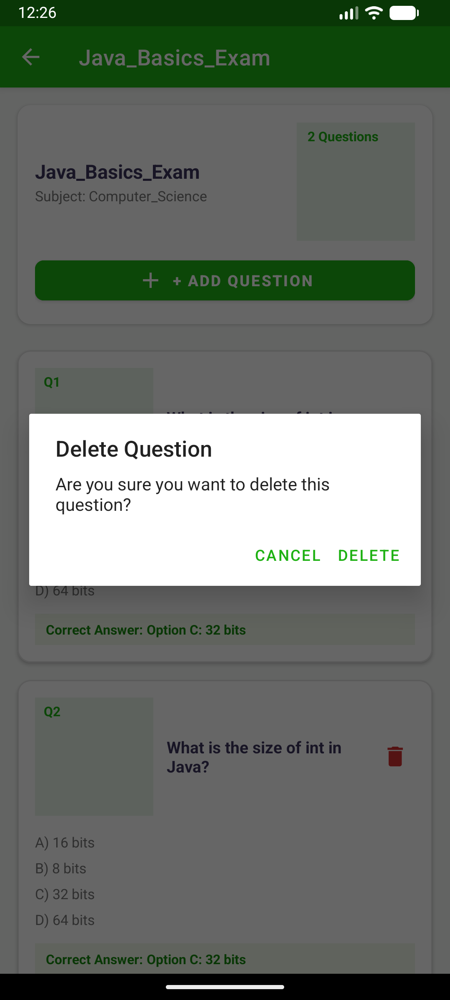
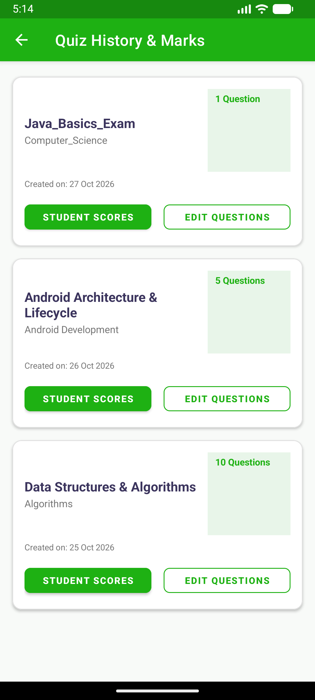
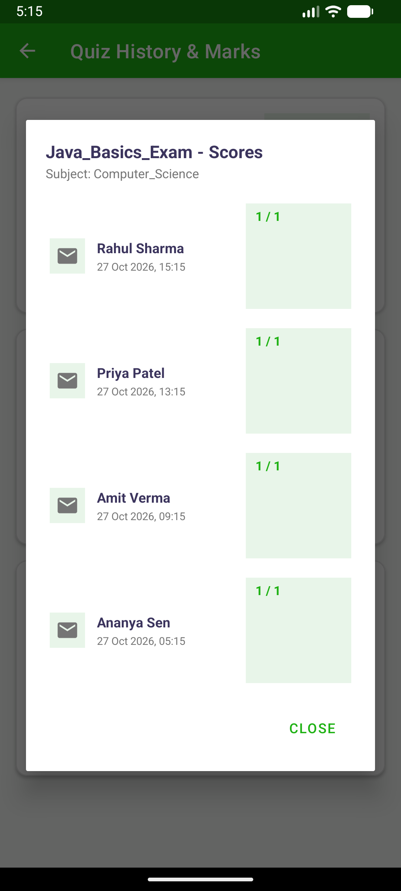

# Teacher's & Recruiter's Portal — Implementation & Verification Report

This document details the complete design, code architecture, and live verification of **Milestone 4: Teacher's / Recruiter's Portal** for the Exam Quiz Application.

---

## 1. Milestone Requirements & Verification Summary

| Requirement | Implementation Details | Status |
| :--- | :--- | :---: |
| **Custom App-Bar Component** | Green Material Toolbar (`#1EB113`) with white typography, elevation, and logout action menu. | **Verified** |
| **Teacher Home Activity** | Styled dashboard with welcome banner, "Create a New Quiz" option card, and "Quiz History" option card. | **Verified** |
| **Create Quiz Workflow** | Examination title and topic inputs with validation, creating a new Quiz entity in Firebase. | **Verified** |
| **Question Management Activity** | `RecyclerView` powered by `QuestionAdapter` displaying questions, options A–D, correct answer highlight, and counter badge. | **Verified** |
| **Add Question Dialog** | Modal dialog with inputs for Question Statement, Options A–D, and a RadioGroup to designate the correct answer. | **Verified** |
| **Delete Question Action** | Confirmation dialog with instant removal from `RecyclerView` and database sync. | **Verified** |
| **Quiz History & Student Marks** | Displays previous quizzes with metadata and opens a "Student Scores" modal dialog showing student names, timestamps, and scores. | **Verified** |

---

## 2. Architecture & Data Flow



---

## 3. Key Components & Source Files

### Activities & Controllers
- [`TeacherHomeActivity.java`](file:///C:/Users/Sreevas/.gemini/antigravity/scratch/ExamQuizApp/app/src/main/java/com/example/quizapp/TeacherHomeActivity.java): Main portal hub with custom App-Bar, navigation to creation flow, and history viewing.
- [`CreateQuizActivity.java`](file:///C:/Users/Sreevas/.gemini/antigravity/scratch/ExamQuizApp/app/src/main/java/com/example/quizapp/CreateQuizActivity.java): Collects quiz metadata (Title, Subject) and initializes the database node.
- [`ManageQuizActivity.java`](file:///C:/Users/Sreevas/.gemini/antigravity/scratch/ExamQuizApp/app/src/main/java/com/example/quizapp/ManageQuizActivity.java): Real-time question manager implementing `RecyclerView`, question counter, and add/delete actions.
- [`TeacherHistoryActivity.java`](file:///C:/Users/Sreevas/.gemini/antigravity/scratch/ExamQuizApp/app/src/main/java/com/example/quizapp/TeacherHistoryActivity.java): Displays all created tests and binds to student performance data.

### Data Models
- [`Quiz.java`](file:///C:/Users/Sreevas/.gemini/antigravity/scratch/ExamQuizApp/app/src/main/java/com/example/quizapp/Quiz.java): Represents a quiz instance (`quizId`, `title`, `topic`, `teacherId`, `questionCount`, `timestamp`).
- [`Question.java`](file:///C:/Users/Sreevas/.gemini/antigravity/scratch/ExamQuizApp/app/src/main/java/com/example/quizapp/Question.java): Represents a multiple-choice question (`questionId`, `question`, `optA`–`optD`, `correctOption`).
- [`QuizResult.java`](file:///C:/Users/Sreevas/.gemini/antigravity/scratch/ExamQuizApp/app/src/main/java/com/example/quizapp/QuizResult.java): Encapsulates student examination marks (`resultId`, `quizId`, `studentName`, `score`, `total`, `timestamp`).

### Adapters & Layouts
- [`QuestionAdapter.java`](file:///C:/Users/Sreevas/.gemini/antigravity/scratch/ExamQuizApp/app/src/main/java/com/example/quizapp/QuestionAdapter.java) & [`item_question.xml`](file:///C:/Users/Sreevas/.gemini/antigravity/scratch/ExamQuizApp/app/src/main/res/layout/item_question.xml): Cards displaying question text, numbered options, green-highlighted correct answer badge, and delete trigger.
- [`QuizHistoryAdapter.java`](file:///C:/Users/Sreevas/.gemini/antigravity/scratch/ExamQuizApp/app/src/main/java/com/example/quizapp/QuizHistoryAdapter.java) & [`item_quiz_history.xml`](file:///C:/Users/Sreevas/.gemini/antigravity/scratch/ExamQuizApp/app/src/main/res/layout/item_quiz_history.xml): Quiz history item view with "Student Scores" and "Edit Questions" action buttons.
- [`StudentScoreAdapter.java`](file:///C:/Users/Sreevas/.gemini/antigravity/scratch/ExamQuizApp/app/src/main/java/com/example/quizapp/StudentScoreAdapter.java) & [`item_student_score.xml`](file:///C:/Users/Sreevas/.gemini/antigravity/scratch/ExamQuizApp/app/src/main/res/layout/item_student_score.xml): Student scorecard layout showing student name, submission timestamp, and score ratio.
- [`dialog_add_question.xml`](file:///C:/Users/Sreevas/.gemini/antigravity/scratch/ExamQuizApp/app/src/main/res/layout/dialog_add_question.xml): Scrollable Material dialog for question authoring.
- [`dialog_student_scores.xml`](file:///C:/Users/Sreevas/.gemini/antigravity/scratch/ExamQuizApp/app/src/main/res/layout/dialog_student_scores.xml): Modal dialog containing the student marks `RecyclerView`.

---

## 4. Live Verification on Android Virtual Device

All screens were deployed and validated live on `emulator-5554` (`Medium_Phone_API_37.0`):

````carousel

<!-- slide -->

<!-- slide -->

<!-- slide -->

<!-- slide -->

<!-- slide -->

<!-- slide -->

<!-- slide -->

````

---

## 5. How to Run & Verify

1. **Launch the Application**:
   - The app can be opened from the emulator launcher or via ADB:
   ```powershell
   & "$env:LOCALAPPDATA\Android\Sdk\platform-tools\adb.exe" shell am start -n com.example.quizapp/.TeacherHomeActivity
   ```
2. **Create a Quiz**:
   - Tap **"CREATE QUIZ NOW"**, enter a Title (e.g. `Data Structures`) and Subject (e.g. `Computer Science`), then tap **"PROCEED TO ADD QUESTIONS"**.
3. **Add & Manage Questions**:
   - Tap **"+ ADD QUESTION"**, enter the question statement and options A through D, select the correct answer radio button, and tap **"ADD"**.
   - Tap the red trash icon on any question to test question deletion.
4. **Inspect Student Scores**:
   - From the Home activity, tap **"VIEW QUIZZES & SCORES"**.
   - Tap **"STUDENT SCORES"** on any quiz card to review participating students and their marks.
